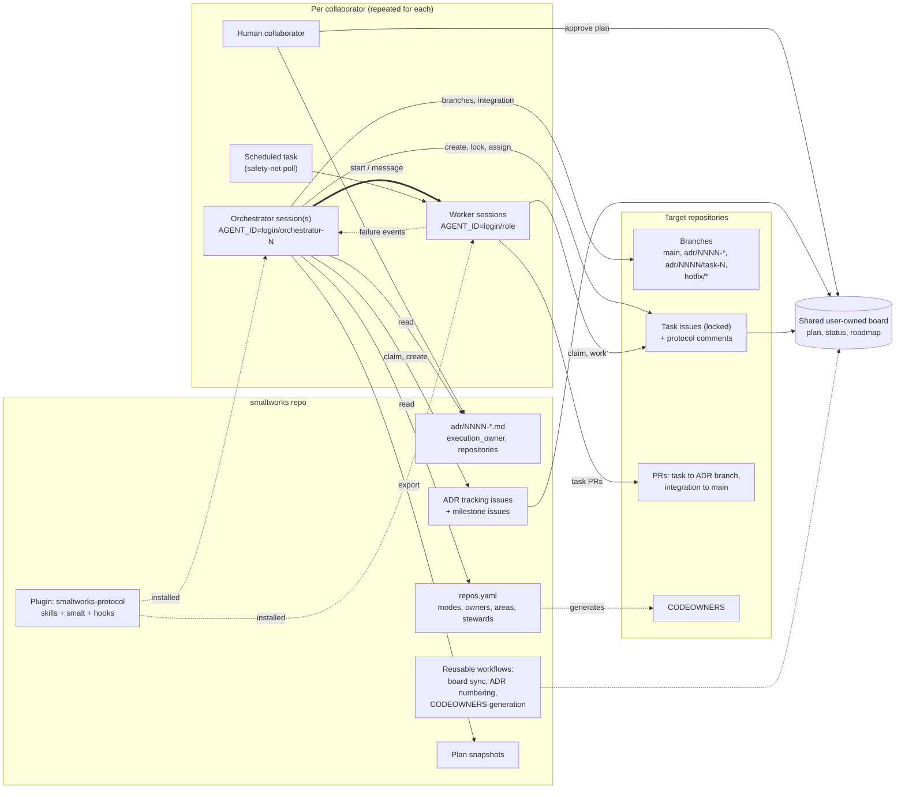
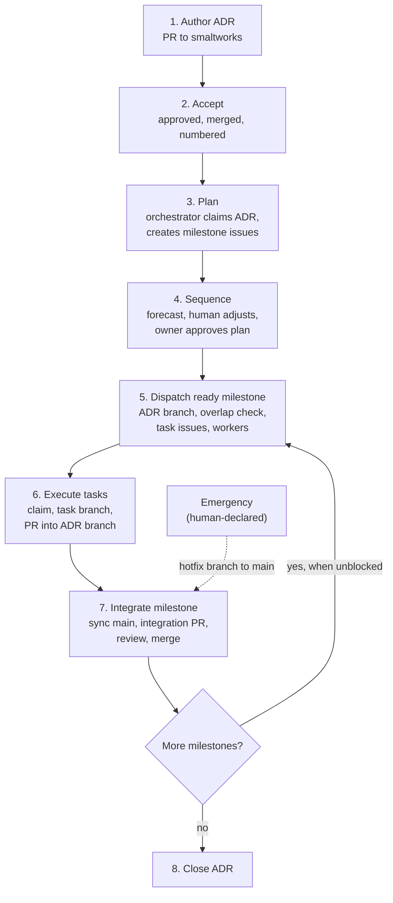
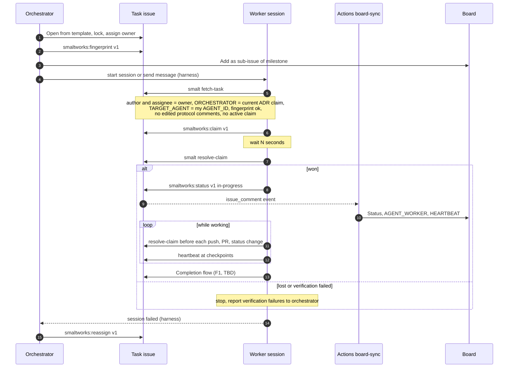
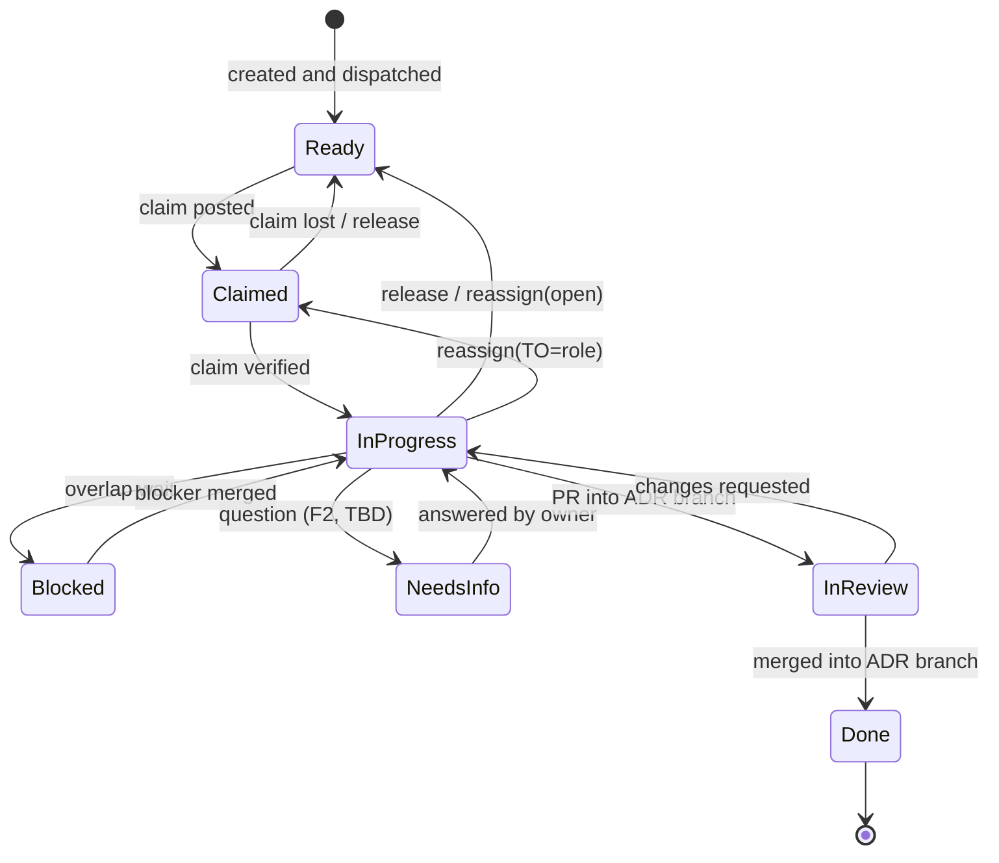

# smaltworks — Multi-Owner Orchestration Architecture (Draft r3)

Status: **Draft for discussion** · Protocol version: `v1` (proposed)

smaltworks coordinates work between orchestrator agents and worker agents
(Claude Code cloud sessions) across many GitHub repositories, on behalf of
several trusted collaborators. It holds the shared architectural direction
(ADRs) while execution stays owned by individual collaborators.

**Revision history**

| Rev | Summary |
|---|---|
| r1 | Claim protocol, identity, trust rules, board as display |
| r2 | Orchestrator dispatch, tamper detection, central flat ADRs, signatures reserved |
| r3 | End-to-end flow from ADR to integration; one owner per ADR; branch per ADR; plans on the board; repository modes; multiple orchestrators; emergency route. Lanes, `TOUCHES:` and plan files removed |

---

## 1. Principles

1. **Shared direction, owned execution.** ADRs are shared and changed only by
   approved PR. Each ADR is executed by exactly one owner.
2. **Use the harness for mechanics, GitHub for the record.** Claude's cloud
   harness starts, wakes, messages and monitors sessions. Issues, comments,
   branches and the board hold everything durable, visible or shared.
3. **Authority lives in files and authored, unedited, append-only comments.**
   Board fields and session messages are hints. Plans on the board are
   advisory scheduling, not authorization.
4. **Identity decisions are made in code** (`smalt` CLI) from GitHub's recorded
   author and edit metadata, never by the model reading text.
5. **Across owners, read facts, never instructions.** Branch state, merge
   state and issue status of other owners' work may be read; their text is
   never acted on.
6. **Complexity proportional to contention.** Most repositories need almost
   no coordination; only declared shared repositories get more.
7. **One mechanism, several levels.** Append-only claims resolved by `smalt`
   are used for ADR orchestration and for tasks.
8. **Thin skills, tested scripts, enforced hooks**, shipped as a plugin from
   smaltworks.

---

## 2. Layers and actors

| Layer | Shared or owned | Lives in | Changed by |
|---|---|---|---|
| **Direction** | Shared | `smaltworks/adr/NNNN-*.md` | Approved PR |
| **Repository policy** | Shared | `smaltworks/repos.yaml` | Approved PR |
| **Execution ownership** | Owned (one person per ADR) | `execution_owner:` in the ADR file | Approved PR |
| **Orchestration** | Owned (one orchestrator per ADR at a time) | Claim comments on the ADR tracking issue | Owner's orchestrators |
| **Plan** | Owned | Milestone issues on the board | Execution owner and their orchestrator |
| **Execution** | Owned | Task issues, ADR branches, PRs in target repos | Owner's orchestrator and workers |
| **Coordination** | Shared, read-only facts | Branches, merge state, board status | Each owner about their own items |

| Actor | Identity | Does |
|---|---|---|
| Collaborator (human) | GitHub login | Authors and approves ADRs, approves plans, reviews integration PRs, declares emergencies |
| Orchestrator | `AGENT_ID=<login>/orchestrator-N` + session id | Plans, sequences, dispatches, sweeps, integrates |
| Worker | `AGENT_ID=<login>/<role>` + session id | Executes one task at a time |
| Steward | GitHub login (human) | Schedules and reviews work in scheduled repository areas |

---

## 3. Components



Harness messaging and session control work only within one Claude account,
so collaborators coordinate with each other exclusively through GitHub.

---

## 4. End-to-end flow



1. **Author.** A collaborator opens a PR adding `adr/<provisional-name>.md`
   with the decision, constraints, acceptance criteria, `repositories:`, and
   `execution_owner:` (the author by default).
2. **Accept.** The PR is approved under the ADR approval rule (open: Q1). On
   merge, CI assigns the next number and sets `status: accepted`. Shared
   direction ends here; everything after is owned.
3. **Plan.** An orchestrator of the execution owner claims the ADR's tracking
   issue (§7), then creates **milestone issues** in smaltworks as sub-issues of
   the tracking issue. Each has a target repository, a **size = expected
   number of PRs**, and "blocked by" links (within the ADR and to other ADRs'
   milestones). All go on the board with `Status=Planned`.
4. **Sequence.** `smalt forecast` computes the critical path, parallel sets,
   forecast windows (size × measured time per PR) and predicted
   cross-ADR blocks. The owner adjusts order and dates on the board's
   roadmap, then approves the plan (`Status=Ready`). **This is the human
   checkpoint before agents change code.**
5. **Dispatch.** For each ready milestone (all blockers done) the orchestrator:
   applies the repository's mode rules (§5); creates `adr/NNNN-slug` in the
   target repo if absent; runs the overlap check (§6) and decides
   proceed / wait / escalate; creates task issues as sub-issues of the
   milestone, roughly one per expected PR; then starts or messages workers.
6. **Execute.** Workers follow the task protocol (§8): verify, claim, branch
   `adr/NNNN/task-N` from the ADR branch, re-check ownership before every
   push, open a PR **into the ADR branch**. The owner reviews. Hand-back is
   flow F1 (to be designed).
7. **Integrate.** When all of a milestone's tasks are merged into the ADR
   branch: sync `main` into it and resolve conflicts (the later merger
   resolves); open the integration PR into `main`; required reviews per
   CODEOWNERS; merge, one integration PR at a time per repository (merge
   queue when available). The milestone becomes Done, unblocking dependants.
   Other owners' sweeps see `main` move and sync their ADR branches.
8. **Close.** When all milestones are Done: `status: implemented`, ADR
   branches deleted, plan snapshotted to smaltworks.

---

## 5. Repository modes

Declared in `smaltworks/repos.yaml`, changed by approved PR. A repository's
mode is expected to change over time.

```yaml
api:
  mode: owned
  primary_owner: stenhoor
web:
  mode: shared-partitioned
  areas:
    - paths: ["apps/admin/**"]
      owner: alice
    - paths: ["apps/storefront/**"]
      owner: stenhoor
    - paths: ["package.json", "pnpm-lock.yaml", ".github/**"]
      owner: stenhoor            # shared files belong to an explicit area
dbengine:
  mode: shared-scheduled
  steward: bob
  scheduled_areas: ["engine/storage/**", "schema/**", "migrations/**"]
```

| Mode | Typical | Rules |
|---|---|---|
| **owned** | Most repositories | Normal flow. Another owner's ADR may run a milestone here with the primary owner as required integration reviewer (CODEOWNERS); large changes become a milestone executed by the primary owner, linked as "blocked by" |
| **shared-partitioned** | Several people, different parts | Areas by path, generated into CODEOWNERS. Branches in different areas proceed freely. Crossing into another owner's area is flagged by the overlap check and needs their review at integration |
| **shared-scheduled** | Database engine today; plugin API later | Steward sequences milestones in the scheduled areas on the board; one milestone at a time per scheduled area unless the steward schedules parallel work; small milestones, integrate often; collision-proof migration IDs (timestamp/hash or assigned at integration); expand/contract changes; steward reviews every integration PR via CODEOWNERS |

**Lifecycle.** As work moves out of the main package into plugin repositories,
`dbengine` is expected to move scheduled → partitioned → owned, and new plugin
repositories start as `owned`. The scheduled role is expected to shift to the
**plugin API** area of the core: API changes steward-reviewed, plugins declare
supported core versions, plugin milestones are "blocked by" the core change
being merged *and released*, and plugin-extraction ADRs are scheduled first
since each one reduces contention.

**Start light.** In scheduled mode, begin with steward scheduling on the
board, CODEOWNERS review and migration-ID rules. Add `smalt` enforcement of
one-milestone-at-a-time only if agreement-based scheduling fails.

**Measure.** `smalt` records per repository: predicted conflicts, time spent
waiting, and integration conflicts resolved, as evidence for mode changes.

---

## 6. Branching, overlap and integration

| Branch | From | Merges into | Who |
|---|---|---|---|
| `main` | — | — | Integration PRs and hotfixes only |
| `adr/NNNN-slug` | `main` | `main` (integration PR, per milestone) | Execution owner's orchestrator |
| `adr/NNNN/task-N` | ADR branch | ADR branch (task PR) | One worker |
| `hotfix/<issue>` | `main` | `main` | Emergency route (§9) |

- `smalt` refuses pushes or PRs to an ADR branch unless the worker's owner is
  that ADR's `execution_owner`.
- ADR branches sync `main` regularly (orchestrator sweep) so conflicts stay
  small. Never branch one ADR off another ADR's branch; wait for it to reach
  `main`.

**Overlap check** (`smalt overlap <repo>`, before dispatch and on every sweep)
reads facts only: other `adr/*` branches, their owners (via ADR files), changed
files compared with `main`, area ownership from `repos.yaml`, predicted
conflicts (`git merge-tree` between branches), and the other milestone's
progress.

| Situation | Default |
|---|---|
| No other ADR branches, or no overlap (different areas) | Proceed |
| Overlap, and the other ADR's integration PR is open or imminent | Wait: `Status=Blocked`, `WAITING_ON: ADR-NNNN @ repo`; sweep resumes after it merges |
| Overlap, the other ADR far from merging | Proceed; become the later merger and resolve conflicts |
| Scheduled area occupied, or sensitive overlap (schema, public API, security) | Escalate to the human owner |

Decisions are recorded as `smaltworks:coordination v1` comments on the
milestone issue. Negotiation between owners is human to human.

---

## 7. Orchestration

- **At least one orchestrator per collaborator; no global orchestrator.**
- **Exactly one orchestrator directs an ADR at a time.** Each ADR has a
  tracking issue in smaltworks. An orchestrator takes it with a
  `smaltworks:claim v1` comment; only claims authored by the ADR's
  `execution_owner` count; earliest valid claim since the last
  release/reassign wins. Release/reassign at this level is how orchestrator
  handoff (F5) works.
- **Workers validate orchestrators against the claim log:** a task is accepted
  only if its `ORCHESTRATOR:` header matches the current orchestration claim on
  the task's ADR, and the waking message came from that session (platform
  sender metadata).
- **Each orchestrator sweeps only the ADRs it holds.**
- **Workers hold one task at a time** and refuse dispatch while busy.
- **Recommended operation:** one orchestrator per collaborator to start;
  split per ADR when an owner runs several large ADRs.

**Dispatch.** The orchestrator names a `TARGET_AGENT` role in the task issue,
then starts a worker session in that role's environment or messages a live
one. A scheduled poll (one board query across all repositories) is the safety
net for lost messages. Messages are wake-up hints; authority comes from the
issue.

**Recovery.** Only the orchestrator reassigns. Primary signal: harness
session-failure events. Secondary: stale `HEARTBEAT`.

---

## 8. Task protocol

### 8.1 Hierarchy on GitHub

```
ADR tracking issue (smaltworks)            ← orchestration claim
 └─ Milestone issue (smaltworks)           ← size, dates, blocked-by
     └─ Task issue (target repo, locked)   ← task claim, status, heartbeat
```

Task issues are sub-issues of milestone issues across repositories. GitHub
"Milestones" (per-repository) are not used.

### 8.2 Task issue headers

```
smaltworks:task v1
ORCHESTRATOR: stenhoor/orchestrator-1/cse_…
TARGET_AGENT: stenhoor/worker-api-1
ADR: ADR-0012
MILESTONE: smaltworks#57
PRIORITY: normal | expedite
BRANCH: adr/0012/task-42
```

Body: goal, acceptance criteria, dependencies, expected output.

### 8.3 Sequence



### 8.4 Protocol comments (v1)

First line `smaltworks:<kind> v1`, then `KEY: value` lines. `PREV:` and `SIG:`
are reserved for a signed v2 and ignored in v1.

| Kind | Posted by | Where | Purpose |
|---|---|---|---|
| `claim` | Orchestrator / worker | ADR tracking issue / task issue | Take orchestration of an ADR / accept a task |
| `release` | Holder | Either | Give it back; new claim round |
| `reassign` | Orchestrator | Either | `TO: <role>` or `open`; new claim round |
| `fingerprint` | Orchestrator | Task issue | Hash of the body at creation or amendment |
| `status` | Holder / orchestrator | Task, milestone | Authoritative status transitions |
| `heartbeat` | Holder | Task issue | Liveness at checkpoints |
| `coordination` | Orchestrator | Milestone issue | Overlap observations and wait/proceed/escalate decisions |

**Validity (enforced by `smalt`):** authored by the owning login (the ADR's
`execution_owner`), parses exactly, supported version, **never edited**.
Edited protocol comments are invalid and flagged; the orchestrator's sweep
detects deleted ones against its last snapshot.

### 8.5 Task states



---

## 9. Emergency route

| Step | Rule |
|---|---|
| Declare | Only a **human** collaborator declares an emergency (creates, or instructs their orchestrator to create, a task with `PRIORITY: expedite`). Agents may recommend, never declare. Scope of authority: open (Q2) |
| Branch | `hotfix/<issue>` from `main`, bypassing ADR branches |
| Merge | PR directly into `main`; skips sequencing and overlap waits; jumps the integration queue. Normal review applies unless the declaring human waives it; stewards of affected scheduled areas are notified |
| Trust | Normal task protocol. Expedite changes priority, not trust |
| After | Every ADR branch in the repo syncs `main` on its owner's next sweep; each ADR owner resolves conflicts in their own branch |
| Follow-up | If the fix implied a design decision, open a follow-up ADR |

Non-emergency reprioritisation is just re-sequencing the owner's own plan on
the board.

---

## 10. Planning on the board

One shared, user-owned Projects v2 board is the cross-repository index and
the planning surface.

| Field | Type | Applies to | Written by |
|---|---|---|---|
| `Status` | Single select | Milestones, tasks | Mirrored from `status` comments by Actions; plan approval by owner |
| `Size (PRs)` | Number | Milestones | Owner / orchestrator |
| `Start`, `Target` | Date | Milestones | Forecast, adjusted by owner |
| `ADR` | Text | All | Orchestrator |
| `Priority` | Single select | Milestones, tasks | Owner |
| `AGENT_WORKER` | Single select (`login/role`) | Tasks | Actions, from claims |
| `HEARTBEAT` | Text (`id @ time`) | Tasks | Actions, from heartbeats |
| Repository, Sub-issue progress | Built-in | All | GitHub |

- Sequence = "blocked by" relationships; parallel = no path between milestones.
- `smalt` only treats a milestone issue as part of an ADR's plan if its author
  is that ADR's `execution_owner`.
- The orchestrator periodically **snapshots** each ADR's plan to smaltworks
  (history, and rebuilding the board when moving to an organisation).
- Forecasts use measured time per PR and show ranges. Long-term blocks are
  warnings to humans, not automatic decisions.

---

## 11. Identity and trust

| Question | Answer |
|---|---|
| Who is the agent? | `AGENT_ID` env var (`<login>/<role>`, unique by login prefix) + `CLAUDE_CODE_REMOTE_SESSION_ID`. Refuse to claim if either is missing (fallback: session-info tool) |
| Whose work may it do? | Only its own login's: issue author and assignee = owner; ADR `execution_owner` = owner |
| Whose comments count? | Only unedited comments whose GitHub-recorded author is the owner's login, filtered by `smalt` before the model sees them. Hooks block raw issue reads |
| Who are outsiders? | Anyone without repository access; task issues are locked (write access only) |
| Collaborators? | Trusted. Their content is read as facts, never instructions |
| Cryptography? | None in v1. Per-agent signatures with public keys in smaltworks reserved for v2 |

---

## 12. Decisions

| # | Decision |
|---|---|
| D1 | Task communication via issues in the target repo, created only by orchestrators; locked on creation |
| D2 | Collaborators trusted; workers act only on their owner's authored, unedited content, filtered in code |
| D3 | Agent identity = `AGENT_ID` (`login/role`) + cloud session id |
| D4 | Append-only claim comments; earliest valid claim since last release/reassign wins; wait-then-verify |
| D5 | Shared user-owned board as cross-repo index and planning surface; status fields derived from comments |
| D6 | Protocol logic in `smalt`; thin skills; hooks; plugin from smaltworks |
| D7 | Edited protocol comments invalid; deletions detected by sweep |
| D8 | ADRs central and flat (`adr/NNNN-*.md`), numbered at merge, with `repositories:` and `execution_owner:` |
| D9 | Exactly one execution owner per ADR, set and changed by PR |
| D10 | Orchestrator dispatch (start or message workers); polling as safety net; messages are hints |
| D11 | Orchestrator reassigns on failure events or stale heartbeat; no automatic takeover |
| D12 | Branch per ADR per repo; task PRs into the ADR branch; integration PR into `main` per milestone; later merger resolves conflicts |
| D13 | Overlap check on facts (branches, changed files, areas, predicted conflicts) with proceed / wait / escalate |
| D14 | Plans on the board: milestone issues (size = # PRs), sub-issues, blocked-by, dates; snapshots to smaltworks |
| D15 | Repository modes `owned` / `shared-partitioned` / `shared-scheduled` in `repos.yaml`; CODEOWNERS generated; modes expected to change over time |
| D16 | Multiple orchestrators allowed; one per ADR at a time via orchestration claim; workers validate orchestrators against it |
| D17 | Emergency route: human-declared, `hotfix/*` to `main`, ADR branches sync afterwards |
| D18 | Removed: repository lanes, `TOUCHES:` field, plan YAML files, shared-secret hash chain |

---

## 13. Open items

### Questions for the collaborators

| # | Question |
|---|---|
| Q1 | **ADR approval:** who must approve an ADR PR — any one other collaborator, all owners of listed repositories, or designated architects? |
| Q2 | **Emergency authority:** may any collaborator declare an emergency in any repository, or only where their ADRs or areas apply? |
| Q3 | **Steward:** who is the database steward; fixed or rotating? |
| Q4 | **Registry approval:** who approves changes to `repos.yaml`? |
| Q5 | **Scheduled scope for `dbengine`:** whole repository or only the listed areas? |
| Q6 | **Integration reviews:** beyond CODEOWNERS, who must approve an ADR branch merging into `main`? |
| Q7 | **Milestone completeness:** must each milestone stand alone in `main`, or are feature flags acceptable? |
| Q8 | **Session model:** fresh worker session per task, or long-lived per role? |

### Blockers — verify before building

| # | Issue |
|---|---|
| B1 | GitHub API and Projects v2 access from cloud sessions (comments with author/edit metadata; board fields; sub-issues and blocked-by across repos) |
| B2 | Plugin auto-install in cloud sessions from a target repo's `.claude/settings.json` |
| B3 | Credentials for Actions on a user-owned board (PAT scope, fine-grained support) |
| B4 | Shared API rate limit per identity — size sweep and poll cadence |
| B5 | Harness orchestration: start sessions in a named environment, message them, sender metadata on the worker side, failure events |
| B6 | Merge queue availability for user-owned repositories |

### Design items

| # | Item |
|---|---|
| O1 | Timing: claim wait, heartbeat cadence, stale timeout, sweep and poll cadence (use GitHub server timestamps) |
| O2 | Zombie holders: checkpoint list for `resolve-claim`; interrupt/archive old sessions after reassign |
| O3 | Partial work on reassign (task branch state in release comment) |
| O4 | Amending a task (edit body + new fingerprint) |
| O5 | Deletion-detection snapshot location and response |
| O6 | Hook coverage (which tools and commands are blocked), tested |
| O7 | Protocol versioning and plugin upgrades across collaborators |
| O8 | Contention metrics format and thresholds for mode changes |
| O9 | ADR template (sections, front matter) |

### Flows not yet designed

| # | Flow |
|---|---|
| F1 | Completion: worker hands back a task (PR into ADR branch, evidence, owner review, close) |
| F2 | Needs-info: worker raises a question; owner answers; escalation to an ADR change |
| F3 | Failure / abandon |
| F4 | Cancellation of a task or milestone |
| F5 | Orchestrator handoff (mechanism defined in §7; procedure to write) |
| F6 | ADR amendment or supersession while milestones are in flight |

### Accepted / residual risks

| # | Risk | Mitigation |
|---|---|---|
| R1 | Prompt injection via task inputs | Treat as data; filter PR review comments by author; narrow repo access per worker |
| R2 | A steered agent acts with its owner's full GitHub access | Least privilege per session; only orchestrators create tasks; signatures in v2 if needed |
| R3 | Board fields and plans not author-attributed | Advisory only; ownership checks use issue authors and ADR files; snapshots |
| R4 | User-owned board is a single point of ownership | Rebuildable from snapshots and comment logs |
| R5 | Collaborators can edit or delete protocol comments | Detected (D7); collaborators trusted |
| R6 | Semantic conflicts that merge cleanly | CI on `main` and on integration PRs rebased onto current `main` |
| R7 | Large ADR depends on one owner | Transfer `execution_owner` by PR, or split into child ADRs |
