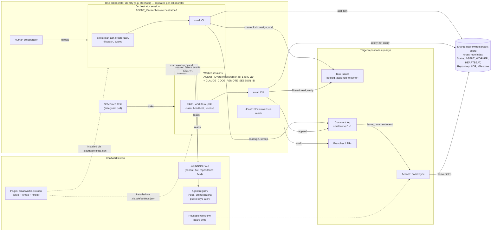
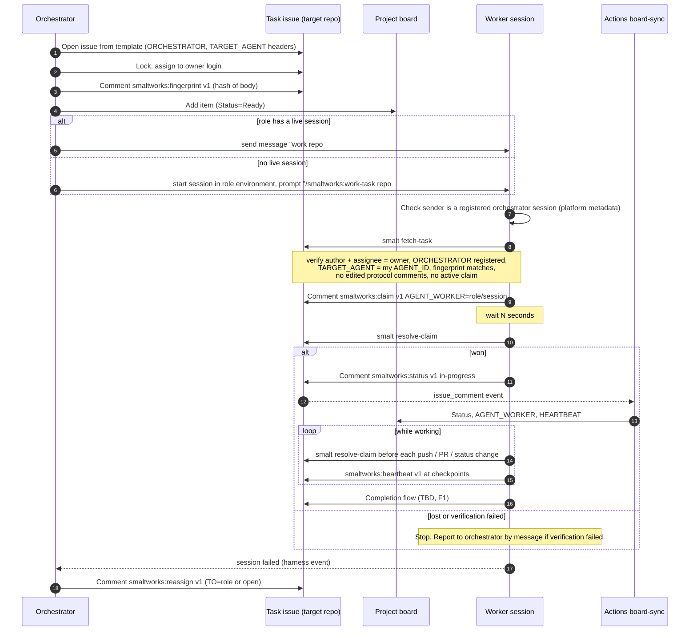
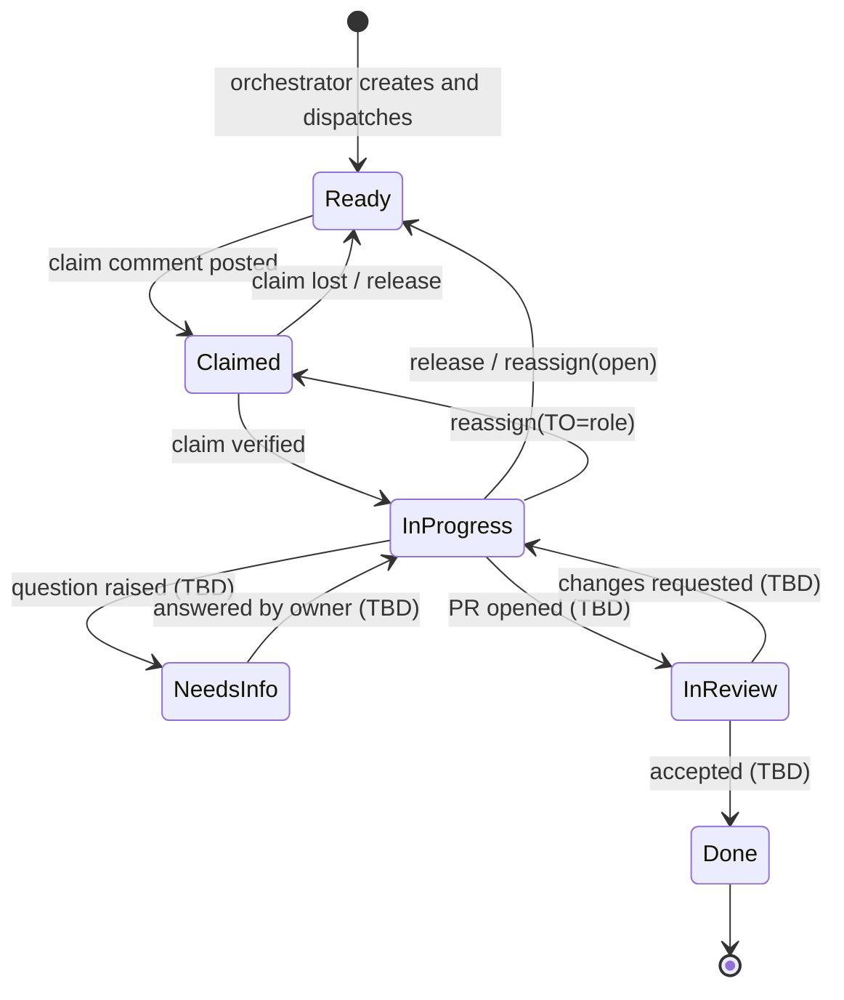

# Orchestrator / Worker Handoff — Architecture Overview (Draft r2)

Status: **Draft for discussion** · Protocol version: `v1` (proposed)

This document captures the handoff model between orchestrator agents and
worker agents running as Claude Code cloud sessions, working across multiple
GitHub repositories on behalf of multiple trusted collaborators.

**Revision 2 changes:** the orchestrator now directs work (starts or messages
worker sessions) instead of workers competing for issues; polling is a safety
net; edited/deleted protocol comments are detected; ADRs are central and flat;
signatures are reserved for a future protocol version.

---

## 1. Principles

1. **Use the harness for mechanics, GitHub for the record.** Claude's cloud
   harness starts, wakes, messages and monitors sessions. GitHub issues, the
   comment log and the shared board hold everything that must be durable,
   visible to people, or shared between collaborators.
2. **Authority lives in authored, unedited, append-only comments.** Board
   fields and session messages are hints, never a source of truth.
3. **Identity decisions are made in code** (`smalt` CLI) from GitHub's recorded
   author (`user.login`) and edit metadata — never by the model reading text.
4. **Ownership is two-level.** Coarse: issue author + assignee = owning
   collaborator. Fine: the winning claim comment = owning agent.
5. **Workers act only on work from their own collaborator's identity.**
   Collaborators are trusted; the filter prevents cross-collaborator mistakes.
6. **Thin skills, tested scripts, enforced hooks.** Protocol logic lives in
   `smalt`; skills say when to call it; hooks block bypassing it. Shipped as a
   plugin from smaltworks.

---

## 2. Components

Each collaborator runs their own orchestrator and workers. Harness messaging
and session control work only within one Claude account, so collaborators
coordinate with each other exclusively through issues and the shared board.

---

## 3. Task lifecycle — dispatch, accept, work

**Safety net:** a scheduled task wakes each worker periodically to run
`smalt poll`, which queries the board for `Status=Ready` tasks targeted at its
role (one query across all repos), then verifies each on the issue exactly as
above. This catches lost messages and sessions that were not running.

---

## 4. Task states

---

## 5. Protocol comments (v1)

All protocol comments start with a `smaltworks:<kind> v1` line, followed by
`KEY: value` lines. Optional `PREV:` and `SIG:` lines are **reserved** for a
future signed version (v2) and ignored in v1.

| Kind | Posted by | Purpose |
|---|---|---|
| `fingerprint` | Orchestrator | Hash of the task body at creation or after an amendment |
| `claim` | Worker | `AGENT_WORKER: <login>/<role>/<session id>` — accept the task |
| `status` | Holder / orchestrator | Status transitions (authoritative; the board mirrors them) |
| `heartbeat` | Holder | Liveness at checkpoints |
| `release` | Holder | Give the task back; starts a new claim round |
| `reassign` | Orchestrator | `TO: <role>` or `open`; starts a new claim round |

**Validity rules (enforced by `smalt`):** a protocol comment counts only if
its GitHub-recorded author is the issue owner's login, it parses exactly, its
version is supported, and **it has never been edited**. The earliest valid
claim after the latest release/reassign wins (ties broken by comment id).

---

## 6. Decisions

| # | Area | Decision |
|---|---|---|
| D1 | Channel | GitHub issues in the target repo, opened only by orchestrators |
| D2 | Protection | Task issues locked on creation (write-access only) |
| D3 | Trust | Collaborators trusted; workers act only on content authored by their owner's login, filtered in code |
| D4 | Agent identity | `AGENT_ID` env var (`<login>/<role>`, org-unique by login prefix) + `CLAUDE_CODE_REMOTE_SESSION_ID`; refuse to claim if either is missing |
| D5 | Claim | Append-only `smaltworks:claim v1`; earliest valid claim since last release/reassign wins; wait-then-verify. With orchestrator dispatch this is mainly an acceptance record, and still resolves races |
| D6 | Release / reassign | `release` (holder only), `reassign` (orchestrator only) start a new claim round |
| D7 | Board | One shared user-owned Projects v2 board; fields derived from comments; orchestrator reconciles |
| D8 | Fields | `Status` (single select), `AGENT_WORKER` (single select, `<login>/<role>`), `HEARTBEAT` (text, `id @ timestamp`), plus `ADR`, `Milestone`, built-in `Repository` |
| D9 | Implementation | Protocol logic in `smalt` CLI; thin skills; hooks block bypass; plugin from smaltworks |
| D10 | Cross-repo index | Issues live in target repos; the board aggregates them; orchestrator adds every task; polling queries the board, authority is verified on the issue |
| D11 | Tamper detection | Edited protocol comments are invalid and flagged; orchestrator sweep detects deleted protocol comments by comparing with its last snapshot |
| D12 | ADR home | Central and flat: `smaltworks/adr/NNNN-title.md` with a `repositories:` field, since one ADR may span several repos |
| D13 | Dispatch | Orchestrator directs work: names a `TARGET_AGENT` role in the issue, then starts a worker session or messages a live one via the harness. Scheduled polling is a safety net only |
| D14 | Messages | Harness messages are wake-up hints. Workers check the sender is a registered orchestrator session, then take all authority from the issue |
| D15 | Recovery | Orchestrator reassigns (no automatic same-role takeover). Primary signal: harness session-failure events; secondary: stale heartbeat |
| D16 | Cryptography | No shared-secret hash chain. Signatures (per-agent key pairs, public keys in the smaltworks registry) reserved for v2 via `PREV:`/`SIG:` lines, adopted only if the trust model tightens |

---

## 7. Open issues

### Blockers — verify before building

| # | Issue | Next step |
|---|---|---|
| B1 | **GitHub API access from cloud sessions.** Provided GitHub tools cover issues/PRs but not Projects v2; direct API access is limited. Decides where `smalt` runs. | Spike: list comments with author + edit metadata; update a test board item. |
| B2 | **Plugin distribution.** Does a session auto-install the smaltworks plugin declared in a target repo's `.claude/settings.json`? | Spike in a test repo. |
| B3 | **Board automation credentials.** Actions on a user-owned board need a PAT (likely classic, `project` scope). | Confirm fine-grained PAT support; document scope and rotation. |
| B4 | **Shared API rate limit** per collaborator identity. | Largely mitigated by D10/D13; size the safety-net poll cadence. |
| B5 | **Harness orchestration.** Confirm an orchestrator session can start sessions in a named environment, message them, see sender metadata on the worker side, and receive failure events. | Spike: orchestrator starts and messages a test worker. |

### Design decisions still open

| # | Issue | Options / notes |
|---|---|---|
| O2 | **Session model.** | (a) Fresh session per task — clean context, no zombies, slower start; (b) long-lived session per role — continuity, needs restarts and context management. Could mix: fresh per task by default. |
| O4 | **Zombie holders.** | `smalt resolve-claim` before every push, PR or status change. Define the checkpoint list. Orchestrator may also interrupt or archive the old session after reassigning. |
| O5 | **Timing parameters.** | Claim wait N, heartbeat cadence, stale timeout, poll cadence. Use GitHub server timestamps. |
| O6 | **Partial work on reassign.** | Branch-per-task naming; release comment records branch state; new holder continues or restarts. |
| O7 | **Amending a task.** | Orchestrator edits body then posts a new `fingerprint` comment; holder re-verifies and re-reads. |
| O8 | **Orchestrator registry.** | Format and location of the registry of roles and orchestrator `AGENT_ID`s (and their current session ids) in smaltworks; how a worker learns the current orchestrator session. |
| O9 | **Task issue template.** | Headers: `ORCHESTRATOR`, `TARGET_AGENT`, `ADR`, `MILESTONE`, protocol version. Body: goal, acceptance criteria, dependencies, branch convention, expected output. |
| O10 | **Cross-repo dependencies.** | Hold blocked tasks back vs. create with `Status=Blocked` and links. |
| O11 | **ADR → milestone → task mapping.** | ADR front matter vs. board fields vs. both; GitHub milestones are per-repo, so cross-repo milestones likely live on the board. |
| O13 | **Hook coverage.** | Exact list of tools/commands to block; must be tested. |
| O14 | **Protocol versioning.** | Version in every comment; `smalt` rejects unknown versions; plugin upgrade policy across collaborators. |
| O15 | **Deletion detection.** | Where the orchestrator's snapshot lives (board field, smaltworks file, or a comment count) and what happens on detection. |

### Flows not yet designed

| # | Flow |
|---|---|
| F1 | Completion: returning a finished work item (PR link, evidence, who accepts, closing) |
| F2 | Needs-info: worker raises a question; owner/orchestrator answers; resume |
| F3 | Failure / abandon |
| F4 | Cancellation by the orchestrator |
| F5 | Orchestrator handoff between orchestrator sessions |

### Accepted / residual risks

| # | Risk | Mitigation |
|---|---|---|
| R1 | Prompt injection via task inputs (code, docs, dependencies, PR reviews). | Treat as data; filter PR review comments by author; narrow repo access per worker. |
| R2 | A steered agent acts with its collaborator's full GitHub access and can post valid comments. | Least-privilege repo access per session; only orchestrators create tasks; signatures (D16) if needed later. |
| R3 | Board fields are not author-attributed. | Display only; orchestrator reconciles from comments. |
| R4 | User-owned board is a single point of ownership. | Rebuildable from comment logs; migrate when an org exists. |
| R5 | Collaborators with write access can edit or delete protocol comments. | D11 detection; collaborators are trusted, so detect-and-flag rather than prevent. |
