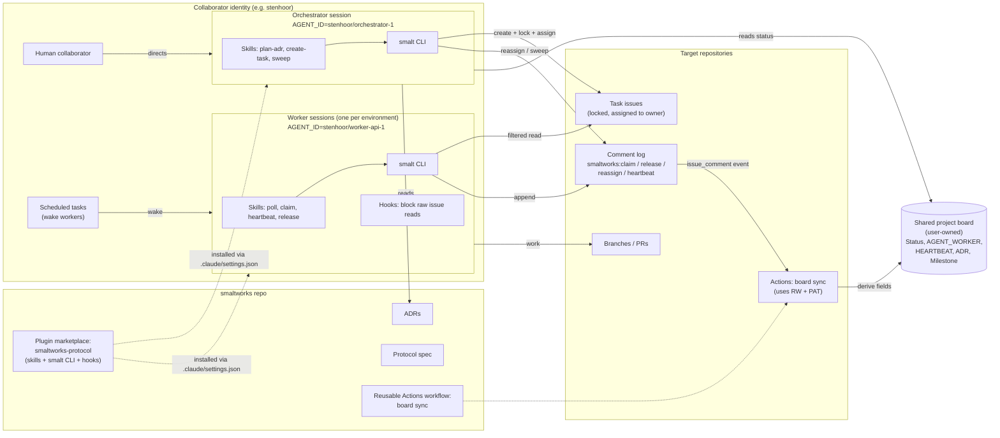
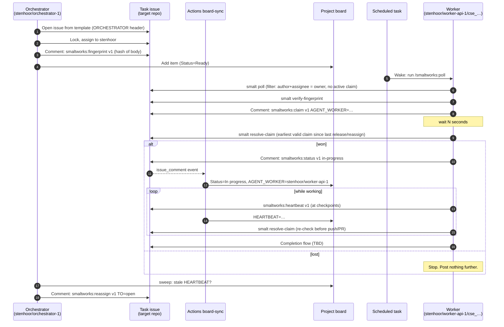
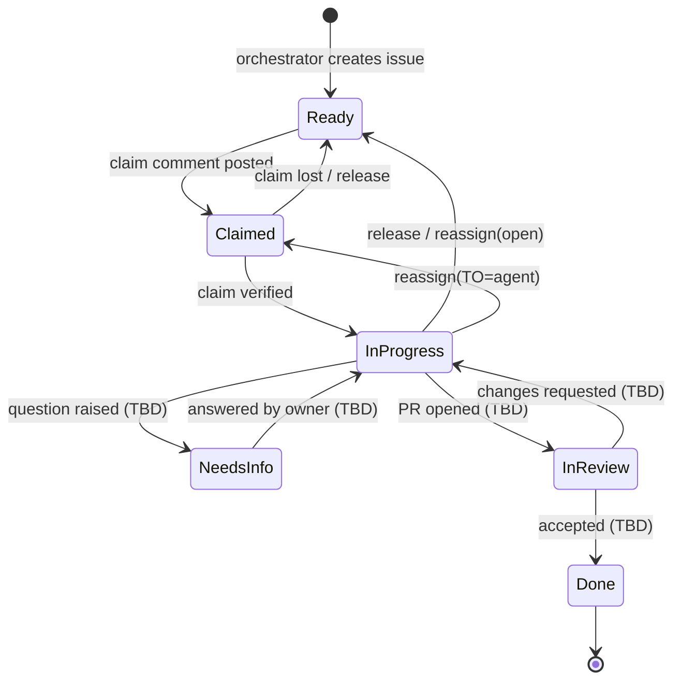

# Orchestrator / Worker Handoff — Architecture Overview (Draft)

Status: **Draft for discussion** · Protocol version: `v1` (proposed)

This document captures the handoff model agreed so far between an
orchestrator agent and worker agents running as Claude cloud sessions, and
lists the open issues that remain before the protocol can be finalised.

---

## 1. Principles

1. **Communication is by GitHub issues.** Orchestrators open task issues in
   the target repository; all coordination happens on that issue.
2. **Authority lives in authored, append-only comments.** Project board
   fields are derived views, never a source of truth.
3. **Identity decisions are made in code**, from GitHub's recorded author
   (`user.login`), never by the model reading text.
4. **Ownership is two-level.** Coarse: issue author + assignee = owning
   collaborator. Fine: the claim comment = owning agent.
5. **Workers act only on work from their own collaborator's identity.**
   Collaborators are trusted; the filter prevents cross-collaborator mistakes.
6. **Protocol logic lives in a CLI (`smalt`)**; skills are thin wrappers that
   say *when* to call it; hooks block bypassing it.

---

## 2. Components

---

## 3. Task lifecycle — create, claim, work

---

## 4. Task states

---

## 5. Decisions so far

| # | Area | Decision |
|---|---|---|
| D1 | Channel | GitHub issues in the target repo, opened only by orchestrators |
| D2 | Protection | Task issues locked on creation (write-access only) |
| D3 | Trust | Collaborators trusted; workers act only on content authored by their owner's login, filtered in code |
| D4 | Agent identity | `AGENT_ID` env var (`<login>/<role>`) + `CLAUDE_CODE_REMOTE_SESSION_ID`; refuse to claim if either missing |
| D5 | Claim | Append-only `smaltworks:claim v1` comment; earliest valid claim since last release/reassign wins; wait-then-verify |
| D6 | Release / reassign | `smaltworks:release v1` (holder only), `smaltworks:reassign v1` (orchestrator only) open a new claim round |
| D7 | Board | One shared user-owned Projects v2 board; fields are derived, comments are authoritative |
| D8 | Fields | `Status` (single select), `AGENT_WORKER` (single select, role), `HEARTBEAT` (text, `id @ timestamp`) |
| D9 | Implementation | Protocol logic in a `smalt` CLI; thin skills; hooks block bypass; shipped as a plugin from smaltworks |

---

## 6. Open issues

### Blockers — must verify before building

| # | Issue | Why it matters | Proposed next step |
|---|---|---|---|
| B1 | **GitHub API access from cloud sessions.** The provided GitHub tools cover issues/PRs but not Projects v2 (GraphQL); direct API access is limited. | Determines whether `smalt` can run inside sessions or only in Actions, and whether agents can write board fields. | Spike: from a cloud session, list issue comments with author metadata and update a test board item. |
| B2 | **Plugin distribution to cloud sessions.** Can a session auto-install a plugin from the smaltworks repo (declared in a target repo's `.claude/settings.json`)? | Without it, skills/CLI/hooks must be copied into every repo and will drift. | Spike: declare the marketplace in a test repo, start a session, confirm skills and hooks load. |
| B3 | **Board automation credentials.** Actions can't use `GITHUB_TOKEN` on a user-owned board; needs a PAT (likely classic, `project` scope). | A broad, long-lived token per repo; secret management and rotation. | Confirm whether fine-grained PATs work on user boards; otherwise document scope and rotation. |
| B4 | **Shared API rate limit.** Every agent of a collaborator uses the same identity and so the same GitHub rate limit. | Polling many repos with many workers can exhaust it and stall everything. | Size polling cadence; prefer orchestrator → worker messaging over polling; cache in `smalt`. |

### Design decisions still open

| # | Issue | Options / notes |
|---|---|---|
| O1 | **Worker triggering.** | Scheduled polling (hourly minimum is typical), orchestrator messages the worker session directly, or both (message as fast path, poll as safety net). |
| O2 | **Session lifecycle.** Who starts worker sessions, and how is "one live session per `AGENT_ID`" ensured? | One environment per role with `AGENT_ID` set; orchestrator starts/restarts sessions; detect duplicates via session id in claims. |
| O3 | **Role takeover.** Can a new session with the same `AGENT_ID` resume its role's in-progress task, or must the orchestrator reassign? | Recommend: orchestrator reassigns (explicit, auditable). |
| O4 | **Zombie holders.** After a reassign, the old session may still be alive and keep working. | `smalt resolve-claim` re-check required before every push, PR, or status change (fencing). Define which actions are checkpoints. |
| O5 | **Timing parameters.** Claim wait N, heartbeat cadence, stale timeout. | Use GitHub server timestamps (comment `created_at`), not session clocks, for staleness. |
| O6 | **Partial work on reassign.** What happens to the old holder's branch/PR? | Convention: branch name per task; new holder continues or restarts; release comment records branch state. |
| O7 | **Fingerprint and legitimate edits.** Orchestrator may need to amend a task. | Orchestrator posts a new `smaltworks:fingerprint` (or `amend`) comment; workers re-verify and re-read. |
| O8 | **Valid orchestrators.** How does a worker know an `ORCHESTRATOR` header is legitimate, and how is an orchestrator handed off? | Registry of orchestrator IDs per collaborator in smaltworks config; orchestrator handoff via the same release/claim pattern on a control issue? |
| O9 | **Task issue template.** | Proposed fields: ADR ref, milestone, repo, acceptance criteria, dependencies, branch convention, expected output, protocol version. |
| O10 | **Cross-repo dependencies.** | Orchestrator holds blocked tasks back vs. opens them with `Status=Blocked` and dependency links. |
| O11 | **ADR home and mapping.** | ADRs move to `smaltworks/adr/<repo>/NNNN-*.md`? Is ADR → milestone → task stored in files, board fields, or both? GitHub milestones are per-repo. |
| O12 | **Comment-format status changes.** Should every status change be a comment (authoritative) and the board purely derived? | Recommended, for consistency with D7; costs comment volume. |
| O13 | **Hook coverage.** Exact list of tools/commands to block (GitHub MCP issue/comment reads, `gh`, `curl` to the API). | Needs to be tested; incomplete blocking silently reopens the injection path. |
| O14 | **Protocol versioning and skew.** Collaborators may run different plugin versions. | Version in every comment (`v1`); `smalt` rejects unknown versions; upgrade policy. |

### Flows not yet designed

| # | Flow |
|---|---|
| F1 | Completion: returning a finished work item (PR link, evidence, who accepts, closes issue) |
| F2 | Needs-info: worker raises a question; who answers; how the answer is authenticated; resume |
| F3 | Failure / abandon: worker cannot complete; error reporting |
| F4 | Cancellation: orchestrator withdraws a task mid-flight |
| F5 | Orchestrator handoff: moving an ADR's work between orchestrators |

### Accepted / residual risks

| # | Risk | Mitigation |
|---|---|---|
| R1 | Prompt injection via task inputs (code, docs, dependencies, PR reviews). | Treat as data; filter PR review comments by author too; narrow repo access per worker. |
| R2 | A steered agent acting with its collaborator's full GitHub access. | Least-privilege repo attachment per session; only orchestrators create tasks. |
| R3 | Board field changes are not author-attributed. | Fields are display only; orchestrator reconciles from comments. |
| R4 | User-owned board is a single point of ownership. | Board is rebuildable from comment logs; migrate when the org exists. |
